# Cảnh báo sớm tàu "shadow fleet" tại eo biển Đan Mạch qua kiểu hành trình AIS

> Dữ liệu: AIS Cục Hàng hải Đan Mạch 04/2025–03/2026 (365 ngày) · nhãn: danh sách trừng phạt EU + UK (OpenSanctions)
> Mã nguồn chính: `features_day.py` → `features_window.py` / `voyage_features.py` → `model_report.py` (`FEATSET=final`) →
> `train_final.py` → `features_rolling.py` + `predict_daily.py` (Spark) → `app.py` (Streamlit)
> Số liệu gốc: `report/final/results.json`, `report/final/insights.json`, `report/final/psi_final.json`

## 0. Tóm tắt

- **Bối cảnh:** mọi chuyến dầu xuất từ các cảng Baltic của Nga đều phải đi qua eo biển Đan Mạch (Skagen, Great Belt, Øresund). Đan Mạch không chặn được tàu, nhưng **kiểm tra** được những tàu neo hoặc đi qua. Bài toán thực tế: trong khoảng 800 tàu dầu đi qua mỗi tháng, **nên ưu tiên để mắt tới tàu nào?**
- **Cách làm:** mỗi ngày, chấm điểm mọi tàu dầu theo khả năng bị EU/UK trừng phạt trong 6 tháng tới. **Mô hình chỉ dùng hành vi AIS**, không dùng hồ sơ tàu (quốc gia, tuổi, kích thước).
- **Kết quả chính:**
  - **Hình mẫu:** tàu sắp bị cấm **không lén lút** ở Đan Mạch: không tắt AIS, hầu như không gặp tàu khác, không ghé cảng. Chúng chạy như **con thoi xuất dầu**: đi ra đầy hàng (mớn nước sâu hơn khoảng **5,7 m** so với lúc đi vào), mỗi lượt ở trong Baltic khoảng **12 ngày**, so với 6,5 ngày ở tàu dầu khác.
  - **Khả năng xếp hạng:** ROC-AUC trên tập test **0,90**. Chấm hằng ngày có ROC-AUC trung vị **0,90**. Những ngày có mặt, tàu sắp bị cấm nằm ở **phân vị 95** về điểm.
  - **Cảnh báo sớm:** 24/34 tàu bị cấm trong giai đoạn kiểm tra đã lọt **top 30 danh sách theo dõi** trước ngày bị liệt kê, sớm hơn **trung vị 81 ngày**. 11 tàu sớm hơn từ 90 ngày trở lên (DOVE, HORAE sớm 6 tháng).
  - **Tàu chưa bị cấm:** tàu từng lọt top 10 về sau bị EU/UK cấm với tỉ lệ **8,0%**, gấp **4 lần** tỉ lệ chung (2,0%).
  - **Bối cảnh lệnh cấm:** tàu dầu **đã** bị cấm vẫn đi qua Đan Mạch, tăng từ 26 tàu/tháng (04/2025) lên **124 tàu/tháng (03/2026), khoảng 13% số tàu dầu**.

## 1. Bài toán

| Thành phần | Định nghĩa |
|---|---|
| Thời điểm chấm (cutoff) | Cuối mỗi tháng khi train; **mỗi ngày** khi vận hành |
| Tàu được chấm | Tàu dầu có ít nhất 10 điểm vị trí hợp lệ trong 30 ngày trước cutoff, và **chưa** bị EU/UK cấm tại cutoff |
| Đầu vào | Chỉ hành vi AIS: cửa sổ 30 ngày (`_l1m`) và hành trình qua gate trong 180 ngày (`v_*`). Chỉ dùng dữ liệu tới cutoff |
| Nhãn | `y=1` nếu tàu bị EU hoặc UK liệt kê **lần đầu** trong khoảng (cutoff, cutoff + 6 tháng] |
| Đầu ra | Điểm rủi ro, dùng để **xếp hạng** và lập danh sách theo dõi (top-K) |

- **Chỉ xét tàu dầu**, vì 98% số lượt dương (219/224) là tàu dầu.
- Hệ thống **không** kết luận vi phạm. Nó chỉ đưa ra thứ tự ưu tiên để con người kiểm tra.

## 2. Dữ liệu

- **AIS:** 365 file ngày, khoảng 18 triệu bản tin mỗi ngày.
  - Ghi bronze → silver: khử trùng lặp (khoảng 40% bản tin trùng nhau) và gắn cờ dòng lỗi. Silver khoảng 61 GB.
  - **Tầng ngày** (Spark, khoảng 70 giây mỗi ngày): tính các đại lượng cộng được cho từng MMSI.
    - Quãng đường, các khoảng mất tín hiệu, mớn nước, điểm đến.
    - Lượt đi qua 3 gate theo hướng ra hoặc vào Baltic.
    - Lưới ô 5 phút để tính thời gian ở cảng và đứng yên, cùng các phiên gặp nhau (cách < 500 m, tốc độ < 3 kn, ngoài cảng).
- **Danh tính tàu:** ghép MMSI theo IMO, không dùng thông tin từ danh sách cấm để ghép (tránh rò nhãn).
- **Nhãn:** OpenSanctions (EU FSF, EU Journal, EU Sanctions Map, UK FCDO). Lấy ngày liệt kê **lần đầu**. Bản tải ngày 01/11/2026, nên mọi khoảng nhãn 6 tháng đều đã đủ dữ liệu.

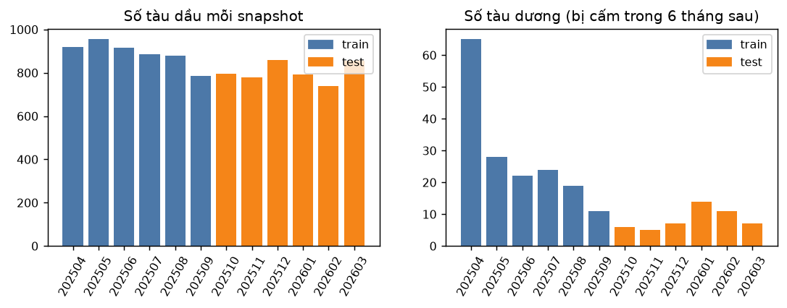

| | Snapshot | Số dòng (tàu × tháng) | Số dòng dương | Số tàu dương khác nhau | Tỉ lệ dương |
|---|---|---|---|---|---|
| Train | 202504–202509 | 5.339 | 169 | 99 | 3,2% |
| Test | 202510–202603 | 4.818 | 50 | 19 | 1,0% |

## 3. RQ1: shadow fleet hành xử thế nào ở eo biển Đan Mạch?

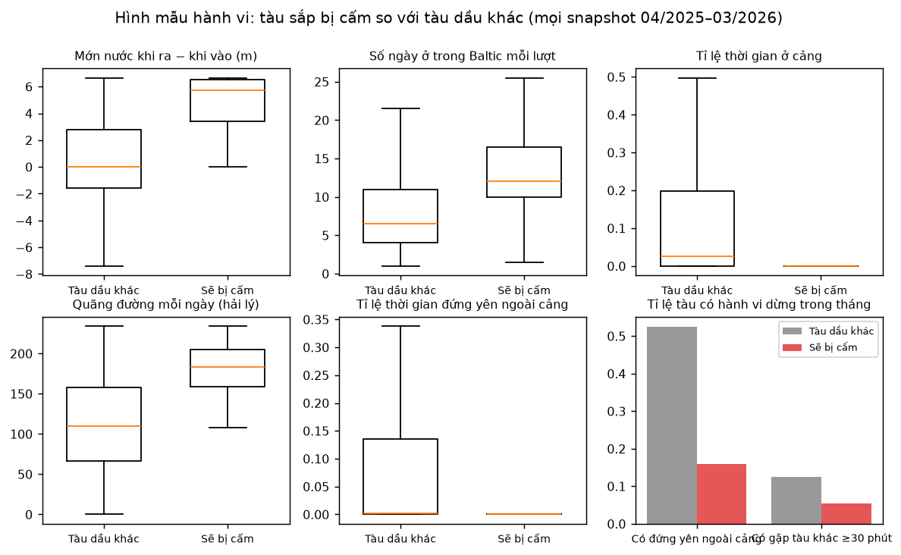

So sánh trung vị trên mọi snapshot:

| | Sẽ bị cấm | Tàu dầu khác |
|---|---|---|
| Mớn nước khi đi ra − khi đi vào | **5,7 m** | 0 m |
| Số ngày ở trong Baltic mỗi lượt | **12** | 6,5 |
| Tỉ lệ thời gian ở cảng | **0%** | 2,6% |
| Quãng đường mỗi ngày | **183 hải lý** | 110 hải lý |
| Tỉ lệ tàu có đứng yên ngoài cảng trong tháng | **16%** | 53% |
| Tỉ lệ tàu có gặp tàu khác ≥ 30 phút trong tháng | **5,5%** | 12,5% |

- **Không lén lút.** Từ 10/2025 đến 03/2026 có 98.434 phiên gặp nhau, chỉ **6** phiên có mặt tàu đã bị cấm và 6 phiên có mặt tàu sắp bị cấm. Shadow fleet không chuyển tải dầu ở vùng này. Các tàu này cũng không tắt AIS khi qua eo biển: khoảng mất tín hiệu dài nhất của chúng *ngắn hơn* tàu khác.
- **Mà là con thoi xuất dầu.** Đi ra Biển Bắc đầy hàng, đi vào Baltic không hàng, mỗi lượt ở lại khoảng 2 tuần (đủ để vào cảng Nga bốc hàng), chạy liền một mạch, không ghé cảng châu Âu.

**Hệ quả cho thiết kế:** điểm rủi ro nên dựa vào **kiểu hành trình**. Các tín hiệu "lén lút" như tắt AIS hay gặp nhau giữa biển chỉ làm luật cảnh báo phụ.

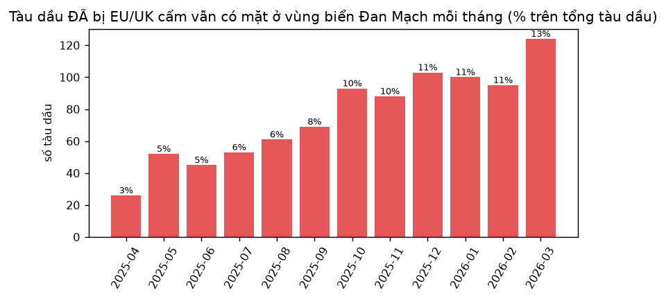

**Bối cảnh:** số tàu dầu **đã** bị cấm vẫn đi qua Đan Mạch tăng đều, từ 26 tàu (2,8% số tàu dầu, 04/2025) lên 124 tàu (12,7%, 03/2026). Lệnh cấm không làm các tàu này ngừng đi qua eo biển. Điều này cho thấy nhu cầu giám sát tại điểm nghẽn là có thật.

## 4. Mô hình

### 4.1. Feature ứng viên (60 feature, đều là hành vi)

| Nhóm | Feature |
|---|---|
| Chuyển động, 30 ngày | quãng đường mỗi ngày, tốc độ trung bình, tỉ lệ thời gian ở cảng, tỉ lệ đứng yên ngoài cảng, lượt qua gate, số ngày có mặt, biên độ mớn nước |
| Mất tín hiệu, 30 ngày | số khoảng trống > 2 giờ / > 6 giờ, tỉ lệ thời gian trống, khoảng trống dài nhất, trống trong vùng có sóng tốt |
| Vị trí bất thường, 30 ngày | nhảy > 50 hải lý, đứng im khi đang chạy, tốc độ khai báo lệch tốc độ tính từ vị trí, thiếu heading/ROT |
| Danh tính và khai báo, 30 ngày | số tên, callsign, điểm đến khác nhau; số MMSI dùng chung một IMO; điểm đến Nga, mơ hồ hoặc trống |
| Gặp gỡ và đồ thị, 30 ngày | số phiên và số giờ gặp, số tàu dầu đã gặp, gặp tàu đã bị cấm, khoảng cách và PageRank tới tàu đã bị cấm trên mạng gặp gỡ |
| **Hành trình qua gate, 180 ngày** | lượt ra/vào mỗi 30 ngày, **mớn nước khi ra so với mức tối đa**, **mớn nước khi ra − khi vào**, **số ngày ở trong Baltic**, nhịp quay vòng, tỉ lệ khai điểm đến Nga, số lần đổi tên/callsign/MMSI/cờ |

### 4.2. Quy trình: chọn feature → so thuật toán → Optuna → test

Mọi lựa chọn đều làm bằng **CV 5 fold chia theo tàu** (`StratifiedGroupKFold`) **chỉ trên tập train**. Tập test chỉ được chấm một lần, ở bước cuối.

| Bước | Cách làm | Còn lại |
|---|---|---|
| 1 | Bỏ cột trống > 95% hoặc chỉ có một giá trị (gồm 6 feature "gặp tàu bị cấm": gần như luôn bằng 0, xem RQ1) | 53 |
| 2 | Với mỗi cặp có Spearman \|ρ\| > 0,95, giữ cột có AUC đơn biến cao hơn | 44 |
| 3 | Xếp hạng theo gain của LightGBM, chọn k nhỏ nhất có CV-AUC ≥ (tốt nhất − 1 SE) | **10** |

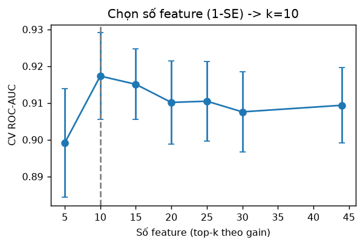

**10 feature được chọn:**
- 5 feature hành trình: mớn nước khi ra so với mức tối đa, mớn nước khi ra − khi vào, số ngày ở trong Baltic, lượt đi vào mỗi 30 ngày, tỉ lệ khai điểm đến Nga.
- 5 feature 30 ngày: quãng đường mỗi ngày, tỉ lệ thời gian ở cảng, tốc độ trung bình, khoảng mất tín hiệu dài nhất, tỉ lệ điểm đến mơ hồ.

**So thuật toán** (tham số mặc định, CV trên train):

| Thuật toán | CV ROC-AUC | CV PR-AUC |
|---|---|---|
| Logistic Regression | 0,877 ± 0,049 | 0,19 |
| Random Forest | 0,911 ± 0,018 | 0,27 |
| **XGBoost** | **0,920 ± 0,024** | **0,31** |
| CatBoost | 0,911 ± 0,032 | 0,30 |
| LightGBM | 0,917 ± 0,026 | 0,31 |

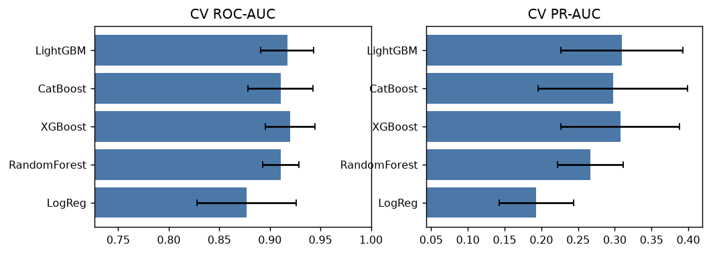

**Optuna** tinh chỉnh XGBoost:
- TPE sampler, 60 lần thử. Lần thử 0 là cấu hình mặc định.
- **CV ROC-AUC tăng từ 0,920 lên 0,922.**
- Tham số tốt nhất: `max_depth=6`, `n_estimators=250`, `learning_rate=0,061`, `reg_lambda=21,6`, `colsample_bytree=0,47`, `subsample=0,81`.

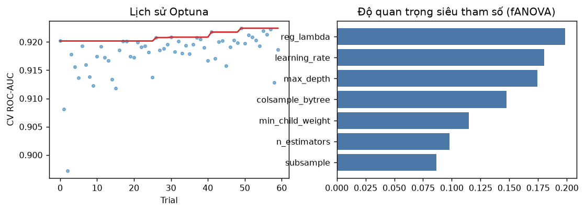

### 4.3. Kết quả trên tập test (202510–202603), chấm một lần

Mỗi mô hình được train lại trên toàn bộ tập train, lấy trung bình 5 seed. Khoảng tin cậy 95% tính bằng bootstrap 1.000 lần, lấy mẫu theo tàu.

| Mô hình | ROC-AUC (CI 95%) | PR-AUC (CI 95%) | Bắt được trong top 30/tháng |
|---|---|---|---|
| Logistic Regression | 0,850 (0,76–0,93) | 0,067 | 12/50 |
| Random Forest | 0,908 (0,87–0,94) | 0,076 | 17/50 |
| XGBoost (mặc định) | 0,901 (0,86–0,94) | 0,083 | 19/50 |
| CatBoost | 0,904 (0,86–0,94) | 0,088 | 18/50 |
| LightGBM | 0,900 (0,86–0,94) | 0,085 | 15/50 |
| **XGBoost + Optuna (mô hình chọn)** | **0,902 (0,86–0,94)** | **0,076 (0,03–0,15)** | **16/50** |

Tỉ lệ dương trong test là 1,0%, nên một mô hình đoán ngẫu nhiên có PR-AUC khoảng 0,01. Mô hình chọn cao hơn **khoảng 8 lần**.

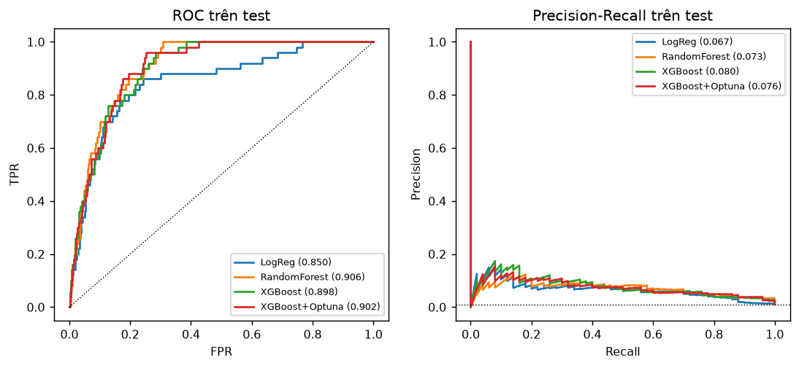
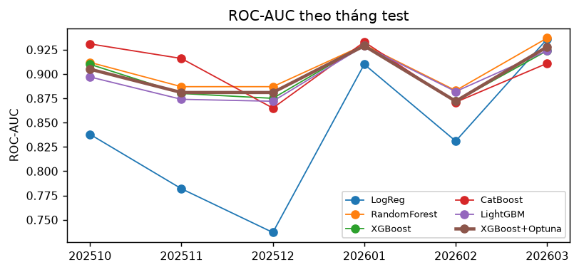
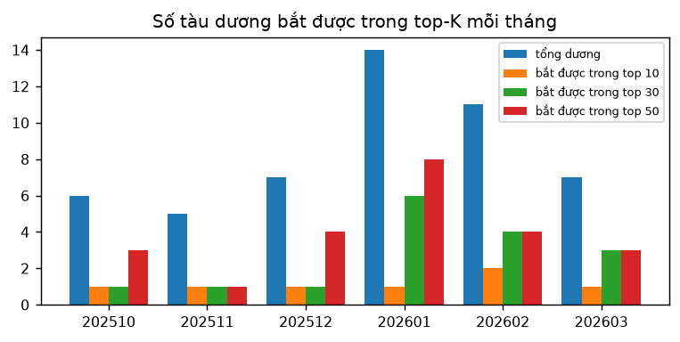

### 4.4. Giải thích (SHAP)

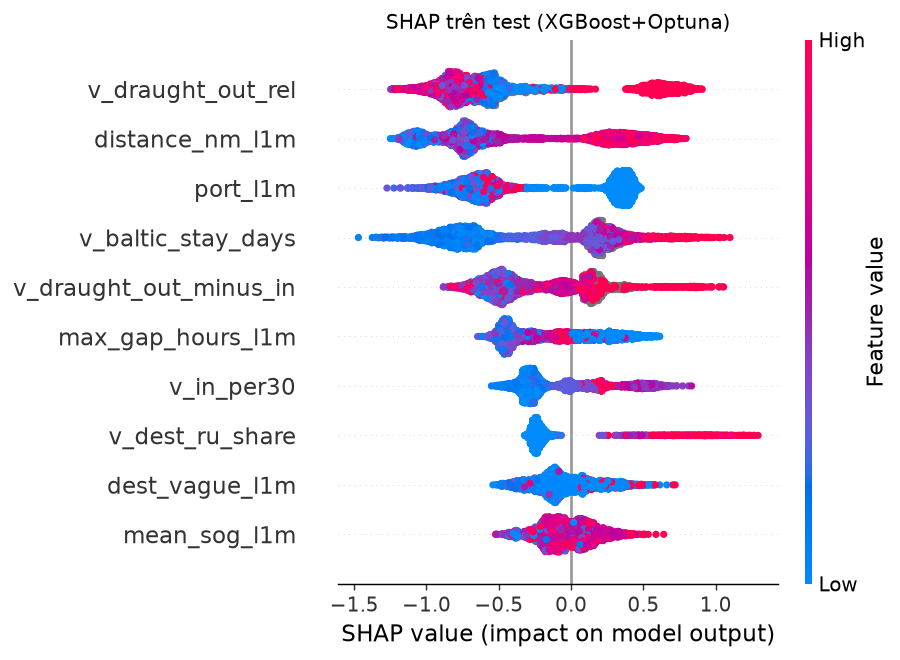

| Feature | Chiều làm **tăng** rủi ro |
|---|---|
| Mớn nước khi ra so với mức tối đa | **cao**: đi ra đầy hàng |
| Quãng đường mỗi ngày | **dài**: đi xuyên qua, không chạy loanh quanh trong vùng |
| Tỉ lệ thời gian ở cảng | **thấp**: không ghé cảng châu Âu |
| Số ngày ở trong Baltic | **nhiều**: ở lại khoảng 2 tuần để bốc hàng |
| Mớn nước khi ra − khi vào | **lớn**: ra có hàng, vào không hàng |
| Khoảng mất tín hiệu dài nhất | **ngắn**: đi liền một mạch, không tắt AIS |
| Lượt đi vào mỗi 30 ngày | **nhiều**: quay vòng đều đặn |
| Tỉ lệ khai điểm đến Nga | **có** |

### 4.5. Độ ổn định (PSI train → test)

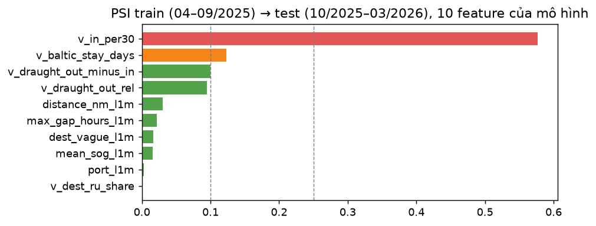

- 9/10 feature có PSI ≤ 0,13, tức ổn định hoặc trôi nhẹ.
- **Lượt đi vào mỗi 30 ngày có PSI 0,58.** Lý do: các snapshot train đầu tiên chỉ có 30–150 ngày lịch sử, nên tỉ lệ tính ra thô hơn. Khi vận hành luôn có đủ 180 ngày lịch sử, nên phải train lại trên dữ liệu đầy đủ (mục 7).

## 5. RQ2 và RQ3: chấm hằng ngày và cảnh báo sớm

**Cách vận hành** (backtest 01/10/2025–31/03/2026, 182 ngày):
- Mỗi ngày tính lại feature trên cửa sổ trượt 30 ngày cộng hành trình 180 ngày, rồi chấm điểm bằng Spark: broadcast mô hình, chấm theo lô trong từng partition.
- Feature tính theo ngày **khớp tuyệt đối** với feature lúc train (sai lệch 0 tại cutoff cuối tháng).
- **Danh sách theo dõi** = top-K trong số tàu thấy trong 3 ngày gần nhất.

| Tháng | 10/25 | 11/25 | 12/25 | 01/26 | 02/26 | 03/26 |
|---|---|---|---|---|---|---|
| ROC-AUC chấm hằng ngày | 0,93 | 0,90 | 0,88 | 0,89 | 0,91 | 0,89 |

- ROC-AUC theo ngày có trung vị **0,90**, thấp nhất 0,81.
- **RQ2:** những ngày tàu có mặt, tàu sẽ bị cấm nằm ở **phân vị 95** về điểm, tàu khác ở phân vị 50.

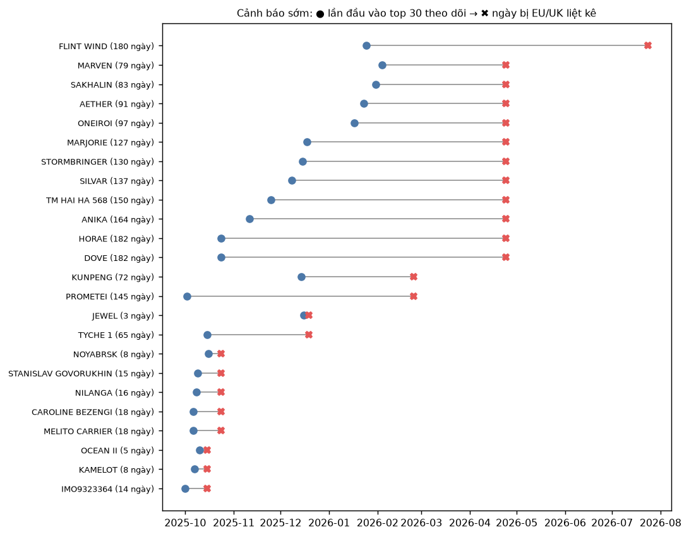

**RQ3, cảnh báo sớm.** Có 34 tàu bị cấm trong 6 tháng sau một ngày chấm nào đó; 27 tàu trong số này có đi qua vùng biển.
- **24 tàu đã lọt top 30 danh sách theo dõi trước ngày bị liệt kê**, sớm hơn trung vị **81 ngày**.
- 15 tàu sớm hơn từ 30 ngày trở lên; 11 tàu sớm hơn từ 90 ngày trở lên.

| Tàu | Bị liệt kê | Lần đầu vào top 30 | Sớm hơn | Hạng tốt nhất |
|---|---|---|---|---|
| DOVE | 24/04/2026 | 24/10/2025 | 182 ngày | 1 |
| HORAE | 24/04/2026 | 24/10/2025 | 182 ngày | 1 |
| FLINT WIND | 24/07/2026 | 25/01/2026 | 180 ngày | 6 |
| ANIKA | 24/04/2026 | 11/11/2025 | 164 ngày | 1 |
| TM HAI HA 568 | 24/04/2026 | 25/11/2025 | 150 ngày | 2 |
| PROMETEI | 24/02/2026 | 02/10/2025 | 145 ngày | 13 |
| MARJORIE | 24/04/2026 | 18/12/2025 | 127 ngày | 1 |
| SAKHALIN | 24/04/2026 | 31/01/2026 | 83 ngày | 2 |

Mức 180 ngày là trần do cách đặt nhãn, nên một số tàu có thể đã nhận ra được còn sớm hơn.

## 6. RQ4: tàu điểm cao nhưng chưa bị EU/UK cấm

| Nhóm tàu | Số tàu | Về sau bị EU/UK cấm (tới 10/2026) |
|---|---|---|
| Từng lọt top 10 | 351 | **8,0%** |
| Từng lọt top 30 | 806 | 4,1% |
| Mọi tàu dầu được chấm | 2.019 | 2,0% |

- Một phần "báo nhầm" là **tàu bị cấm muộn hơn 6 tháng**: SOLVANTE, TALUREX (08/2026), BELLARIS, SOLSTRAUM, KORD ARCTIC, ANAYA, DAPHNE V (07/2026).
- Các tàu ở top 10 nhiều ngày nhất mà chưa bị EU/UK cấm: ARRHENIUS (28 ngày), KAI 1, KNOSSOS, FIDAN, TAVIAN, DUKE II, WARRIOR SPIRIT, ORSA, MIDEA, GATTACA. Đây là danh sách **ứng viên** để đối chiếu với OFAC (Mỹ) và GUR (Ukraine). Báo cáo **không** khẳng định các tàu này thuộc shadow fleet.

## 7. Hệ thống và vận hành

| Lớp | Thành phần | Tần suất |
|---|---|---|
| Batch | Silver → tầng ngày (Spark) → feature trượt → **chấm điểm Spark** → `predict/date=D` | Hằng ngày |
| Train lại | Như mục 4, với snapshot mới nhất có nhãn đủ 6 tháng | Hằng tháng, hoặc sau mỗi đợt cấm. Lệnh cấm ra theo đợt: 514 tàu chỉ rơi vào 17 ngày trong 18 tháng |
| Streaming | Luật theo phút: **tàu điểm cao đang tiến vào hoặc vừa qua gate Skagen / Great Belt / Øresund** (luật chính); mất tín hiệu trong vùng có sóng tốt, vị trí nhảy (luật phụ) | Theo phút |
| Phục vụ | App Streamlit: danh sách hằng ngày, chi tiết tàu, đồ thị gặp gỡ, cảnh báo sớm, đánh giá | Theo yêu cầu |

## 8. Hạn chế

1. **Nhãn là nhãn thay thế.** Lệnh cấm EU/UK không phủ hết shadow fleet. Điểm cao không có nghĩa là vi phạm.
2. **Tập test nhỏ.** 50 lượt dương chỉ đến từ 19 tàu, nên khoảng tin cậy rộng: ROC-AUC 0,86–0,94, PR-AUC 0,03–0,15. Các thuật toán chênh nhau ít hơn độ rộng khoảng tin cậy.
3. **Mớn nước do tàu tự khai báo.** Hiện tại chính số liệu khai báo đó là tín hiệu; nếu tàu đổi cách khai, tín hiệu có thể yếu đi.
4. **Phân phối trôi do lịch sử ngắn** ở các snapshot train đầu tiên (mục 4.5).
5. **Chỉ quan sát được vùng Đan Mạch.** Hành vi tắt AIS hay chuyển tải ở vùng khác (vịnh Phần Lan, Hy Lạp…) nằm ngoài dữ liệu.
